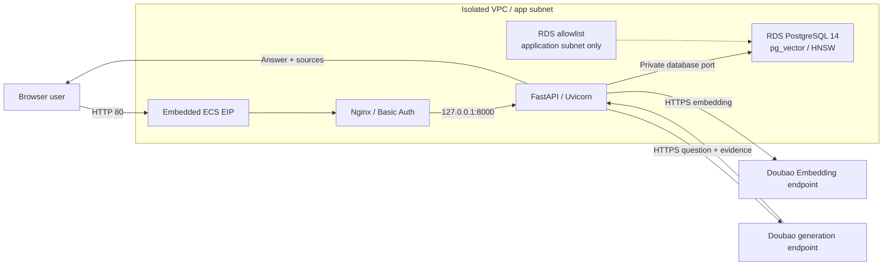

# Enterprise Knowledge QA on Volcengine

Use Terraform and the `volcengine/volcenginecc` provider to create a VPC, ECS host, RDS PostgreSQL 14, and Doubao model endpoints on Volcengine. The template automatically installs an enterprise knowledge QA application built with Nginx, FastAPI/Uvicorn, pg_vector, and HNSW. Users can upload TXT, Markdown, PDF, and DOCX documents and receive RAG answers with source evidence. The solution is intended for demonstrations, functional validation, and small noncritical workloads.

## 1. Business Background

Enterprise customer service and internal QA need answers grounded in product documentation, operating procedures, and business rules. General-purpose language models cannot directly meet these requirements.

- **Missing private knowledge**: models do not know internal enterprise documents or reliably track changing business rules.
- **Unclear answer provenance**: directly generated answers lack verifiable sources, making their reliability difficult to assess.
- **Costly knowledge maintenance**: inconsistent document formats make manual organization and individual QA updates time-consuming.

This solution retrieves enterprise knowledge before generation and combines the question with relevant passages in a prompt. Document ingestion, vector retrieval, answer generation, and evidence display let users maintain knowledge and verify the basis of an answer.

## 2. Solution Overview

- **Network**: creates an isolated VPC, application subnet, and security group. Public ingress includes HTTP 80 and optional SSH 22; parameters control the allowed sources.
- **Compute**: creates an Ubuntu 24.04 ECS instance with an embedded EIP. Nginx provides Basic Auth and reverse proxying; FastAPI/Uvicorn listens only on `127.0.0.1:8000`.
- **Database**: creates RDS PostgreSQL 14, an application-subnet allowlist, a UTF-8 database, and a bootstrap account, with private connectivity only.
- **Models**: creates Doubao generation and embedding Ark endpoints by default, or reuses existing endpoints.
- **Delivery**: stores non-secret application source in TOS. ECS cloud-init downloads and verifies it, then systemd automatically installs the application, initializes the database, and checks application health.



Ingestion follows upload → validate and parse → chunk → embed → store in PostgreSQL. Question answering follows query embedding → HNSW Top K cosine retrieval → distance filtering → prompt composition → generation → source, chunk, and distance display. Reuploading the same filename atomically replaces its previous chunks; generation is skipped when no evidence meets the threshold.

Defaults are `doubao-seed-2-0-lite / 260428`, `doubao-embedding-vision / 251215`, and 1024 dimensions. Confirm region, model-version, and output-dimension availability before deployment. The database port comes from the `postgres_private_port` output.

The public TOS object contains source code only. Passwords and the Ark API Key are delivered through ECS user data and stored in Terraform State. `sensitive = true` only redacts normal output; Base64 encoding does not provide encryption. Before deployment, prepare encrypted State storage with restricted access and separate environments.

## 3. IaC Design

### 3.1 Resource Inventory

The current `terraform.tfvars` uses `create_model_endpoints = true`: it creates 12 cloud resources, plus two destroy-only waits and two validation objects, for 16 Terraform-managed objects. Endpoint reuse creates 10 cloud resources and the same four auxiliary objects.

| Terraform Resource | Count | Purpose |
| --- | ---: | --- |
| `volcenginecc_vpc_vpc` | 1 | Isolated VPC |
| `volcenginecc_vpc_subnet` | 1 | ECS and RDS application subnet |
| `volcenginecc_vpc_security_group` | 1 | HTTP and optional SSH source control |
| `volcenginecc_ecs_instance` | 1 | Application host, system disk, primary ENI, and embedded EIP |
| `volcenginecc_rdspostgresql_allow_list` | 1 | Allows only the application subnet to access RDS |
| `volcenginecc_rdspostgresql_instance` | 1 | PostgreSQL 14 primary and secondary nodes |
| `volcenginecc_rdspostgresql_database` | 1 | UTF-8 RAG database |
| `volcenginecc_rdspostgresql_db_account` | 1 | RDS Super bootstrap account |
| `volcenginecc_ark_endpoint` | 2 or 0 | New generation and embedding endpoints; omitted in reuse mode |
| `volcenginecc_tos_bucket` | 1 | Source-delivery bucket |
| `volcenginecc_tos_object` | 1 | Public source object without secrets |
| `time_sleep` | 2 | Waits for allowlist and network detachment during destruction |
| `terraform_data` | 2 | Runtime-input, login-mode, and endpoint-selection validation |

EIP, system disk, primary ENI, and RDS nodes are embedded in parent resources and are not counted separately. The installer creates the `ragapp` SQL role, Web credentials, and application software on ECS; these are not separate Terraform cloud resources.

There are no data sources, IAM Role or Policy resources, or Cloud Assistant Command or Invocation resources. The caller supplies an existing ECS key pair in key-pair mode, a manually created Ark API Key, and two endpoint IDs in reuse mode.

### 3.2 Project Structure

```text
.
├── modules/
│   ├── network/
│   │   ├── main.tf
│   │   ├── variables.tf
│   │   ├── outputs.tf
│   │   └── versions.tf
│   ├── database/
│   │   ├── main.tf
│   │   ├── variables.tf
│   │   ├── outputs.tf
│   │   └── versions.tf
│   ├── inference/
│   │   ├── main.tf
│   │   ├── variables.tf
│   │   ├── outputs.tf
│   │   └── versions.tf
│   ├── delivery/
│   │   ├── main.tf
│   │   ├── variables.tf
│   │   ├── outputs.tf
│   │   ├── versions.tf
│   │   └── templates/
│   │       ├── auto-install.sh
│   │       └── ecs-runtime.py
│   └── compute/
│       ├── main.tf
│       ├── variables.tf
│       ├── outputs.tf
│       ├── versions.tf
│       └── templates/
│           └── bootstrap-host.sh.tftpl
├── app/
│   ├── main.py
│   ├── requirements.txt
│   ├── static/
│   │   └── style.css
│   └── templates/
│       └── index.html
├── main.tf
├── locals.tf
├── variables.tf
├── outputs.tf
├── providers.tf
├── versions.tf
├── terraform.tfvars
├── README.md
├── README.zh-CN.md
└── LICENSE
```

`network` provides the VPC, subnet, and security group; `database` uses that network to create a private database; `inference` creates or selects model endpoints; `delivery` packages source code; and `compute` receives database, model, and source information to start automatic installation. The root module normalizes login credentials and builds runtime configuration in `locals.tf`.

### 3.3 Key Code Examples

The root `main.tf` passes network outputs to the database module and controls cleanup order with a destroy-only wait:

```hcl
resource "time_sleep" "before_network_destroy" {
  destroy_duration = "60s"
  depends_on       = [module.network]
}

module "database" {
  source = "./modules/database"

  name_prefix       = var.name_prefix
  project_name      = var.project_name
  zone_id           = var.zone_id
  vpc_id            = module.network.vpc_id
  subnet_id         = module.network.subnet_id
  subnet_cidr       = var.subnet_cidr
  db_engine_version = var.postgres_version
  node_spec         = var.postgres_node_spec
  storage_space_gb  = var.postgres_storage_gb
  database_name     = var.postgres_database_name
  admin_username    = var.postgres_admin_username
  admin_password    = var.postgres_admin_password
  tags_list         = local.tags_list
  depends_on        = [time_sleep.before_network_destroy]
}
```

The database module binds the application-subnet allowlist through `allow_list_ids`. During destruction, it waits another 300 seconds before removing the allowlist; the root module waits for network detachment before removing VPC resources. These waits apply only during destruction.

## 4. Usage

This project supports cloud deployment through InfraManager or local deployment using the downloaded template. Cloud deployment is recommended: you do not need to prepare a Terraform runtime, and you can create and manage resources by entering parameters in the platform.

### 4.1 Cloud Deployment

InfraManager is Volcengine's managed Terraform workspace. For more information, see the [InfraManager product introduction](https://docs.volcengine.com/docs/infrastructure-management/product-introduction?lang=zh).

#### 4.1.1 Prepare Permissions

The stack execution identity needs CloudControl permissions and permissions to create, read, update, delete, tag, and associate VPCs, subnets, security groups, ECS resources (including disks, ENIs, EIPs, and key-pair binding), RDS PostgreSQL resources (including allowlists, accounts, and databases), Ark endpoints, and TOS buckets/objects. Reuse mode also requires permission to use the target endpoints. The template creates no IAM roles, so creating its resources does not require adding `iam:CreateRole` or `iam:PassRole`.

Enable ECS, RDS PostgreSQL, TOS, and Ark in their consoles. Confirm that the region has an Ubuntu 24.04 x86_64 image, available ECS/RDS instance types, EIP and storage quotas, and access to both models. Defaults use Beijing (`cn-beijing`) and zone `cn-beijing-a`. ECS must reach TOS, Ubuntu repositories, Python package repositories, and Ark HTTPS APIs.

`ark_api_key` authenticates inference requests. It differs from cloud AK/SK credentials and an `ep-...` endpoint ID, and the template does not create it:

1. Open the [Ark console](https://console.volcengine.com/ark), select the deployment region, and switch to the project matching `project_name`, which defaults to `default`. The API Key and both endpoints must belong to the same project.
2. Create an API Key in [API Key Management](https://ark.volcengine.com/region:cn-beijing/apiKey). It must authorize both the generation and Embedding endpoints. In create mode, do not restrict it to previously existing endpoints only; in reuse mode, access can be limited to the two target endpoints.
3. Copy the complete Key into the stack's sensitive `ark_api_key` parameter. For local environment-variable injection, see Section 4.2.1. Refer to the [official API Key guide](https://docs.volcengine.com/docs/ark/api-key?lang=zh) for instructions.

#### 4.1.2 Select the Template

Open the [InfraManager console](https://console.volcengine.com/iac), go to **Template Management > Public Templates**, and search for “快速搭建企业智能问答系统”.

The public template becomes searchable after platform publication. To use a locally revised version, import the complete template package containing the root files, `modules/`, and `app/` into Template Management, then create a stack from the imported template.

#### 4.1.3 Create a Stack

Select the template and click **Create Stack**. Enter the stack information and template parameters for your requirements. Create and review the execution plan, then click **Deploy** after confirming the changes are as expected.

Supply `image_id`, `web_source_cidr`, `postgres_admin_password`, `ark_api_key`, and the ECS credential matching the login mode. The complete parameter table is in Section 4.2.1; cloud and local deployments use the same constraints.

Before deployment, review the package's `terraform.tfvars`: the image and key-pair name must belong to the target region; Web and SSH example sources are both `0.0.0.0/0` and should be changed to actual egress CIDRs, or SSH set to `null`; the example RDS type is `rds.postgres.2c4g`. Password mode requires an empty `key_pair_name` and an actual `ecs_password`. Do not use the example password default in the code.

`postgres_admin_password` has no default and does not allow `null`; replace the `ark_api_key` example. When using platform sensitive inputs, confirm that the plan uses the supplied values and that package assignments do not override credentials. Review the create/reuse endpoint selection and every deletion or replacement.

#### 4.1.4 Verify the Deployment

Confirm that the deployment status is successful on the stack details page, then review the template outputs:

| Output | Purpose |
| --- | --- |
| `web_url` | Public HTTP application URL |
| `ecs_instance_id` | Locate the application host in the ECS console |
| `ecs_public_ip` | ECS public IP |
| `ecs_private_ip` | ECS private IP |
| `ecs_login_mode` | ECS login mode |
| `ecs_key_pair_name` | Existing key-pair name bound in key-pair mode; empty in password mode |
| `postgres_instance_id` | Locate the database in the RDS console |
| `postgres_private_domain` | Actual private connection domain |
| `postgres_private_port` | Actual private connection port |
| `postgres_database_name` | RAG database name |
| `llm_endpoint_id` | Effective generation endpoint |
| `embedding_endpoint_id` | Effective embedding endpoint |
| `embedding_dimensions` | Configured vector dimensions |
| `vpc_id` | VPC identifier |
| `subnet_id` | Application subnet identifier |
| `security_group_id` | Security group identifier |
| `source_bucket_name` | TOS source bucket |
| `runtime_config` | Non-secret region, Ark URL, chunking, and retrieval configuration |
| `deployment_next_step` | Application-readiness and Web-credential instructions |

None of these outputs returns passwords or API Keys; this does not mean that State contains no secrets. The resources tab should show 12 cloud resources and four auxiliary objects in create mode, or 10 cloud resources and four auxiliary objects in reuse mode.

1. **Check cloud resources and relationships.** Use the identifiers above to open the relevant console details: ECS should be running; RDS should be available with private addresses only; its allowlist should contain only `subnet_cidr`; the security group should allow configured sources on 80 and optional 22, with no public database-port or 8000 ingress; and both Ark endpoints should be callable. In reuse mode, output IDs must match input IDs. First investigate source CIDRs, the allowlist, instance status, and model permissions if anything differs.

2. **Check installation and health on ECS.** Locate the instance matching `ecs_instance_id` in the ECS console, open its console terminal, and run these commands using an account with sudo permissions:

```bash
sudo cat /opt/rag-qa-deploy/STATUS
sudo systemctl is-active nginx rag-qa.service
curl --fail --silent --show-error --max-time 15 http://127.0.0.1:8000/healthz
curl --silent --output /dev/null --write-out '%{http_code}\n' --max-time 15 http://127.0.0.1/
```

Expected results are `ready`, two `active` lines, `{"ok":true,"database":"ready"}`, and `401` for the unauthenticated request. Application installation can continue after cloud resources have been created. If results differ, inspect:

```bash
sudo systemctl status rag-qa-install.service rag-qa.service nginx --no-pager
sudo journalctl -u rag-qa-install.service -u rag-qa.service -n 80 --no-pager
```

Installation runs automatically; there is no need to execute source scripts manually. For download or dependency failures, check ECS outbound connectivity; for database failures, check private connectivity and the allowlist; for model failures, check the API Key, project permissions, endpoints, and dimensions. Do not print `config.json` or `.runtime/runtime.env` during troubleshooting because they contain secrets. To pause installation retries, use `sudo systemctl stop rag-qa-install.service`; to stop the application, use `sudo systemctl stop rag-qa.service`; resume with the corresponding `systemctl start`.

3. **Read Web credentials and sign in.** Run this command on ECS; it displays only the Web username and password:

```bash
sudo python3 -c 'import json; s=json.load(open("/opt/rag-qa-deploy/.runtime/secrets.json")); print("web_username", s["web_username"]); print("web_password", s["web_password"])'
```

Open the stack's `web_url` in a browser and enter the two fields in the login dialog. These application-generated credentials differ from ECS and database credentials.

4. **Verify ingestion and question answering.** Prepare `qa-check.txt`, `qa-check.md`, `qa-check.pdf`, and `qa-check.docx` with clear factual content and upload them individually through the page. The PDF must contain extractable text, and the DOCX must be a valid document. Each upload should return the source and chunk count. Ask about known facts in a document and confirm a matching answer with source evidence. Ask a clearly unrelated question: when retrieval finds no qualifying evidence, the application should refuse to answer. Edit and reupload a file with the same name to confirm replacement of its previous chunks.

Query knowledge status on ECS. At the prompts, enter the Web username you just retrieved, then its password; the password is not placed in command arguments:

```bash
read -r -p "Web username: " QA_WEB_USERNAME
curl --fail --silent --show-error --max-time 30 --user "$QA_WEB_USERNAME" http://127.0.0.1/api/knowledge
unset QA_WEB_USERNAME
```

After uploading, expect `ok = true`, `chunks > 0`, `configured_dimensions`, `min_dimensions`, and `max_dimensions` equal to the configured value (1024 by default), and `knowledge_chunks_embedding_hnsw` in `indexes`. Check installer and application logs first if this fails. Empty, corrupted, unsupported, and oversized files exceeding `max_upload_bytes` should be rejected without adding chunks; Nginx may also return `413` for oversized requests. Record status after valid uploads and compare it after invalid submissions.

Run `sudo systemctl restart rag-qa.service` on ECS, then repeat health, knowledge-status, and known-question checks. Data and indexes should remain usable.

5. **Remove verification data.** The application has no document-delete button or deletion API. To remove only the four test files above, run this command on ECS. It deletes chunks by those exact filenames; first confirm that no business documents use the same names:

```bash
sudo /opt/rag-qa-deploy/release/.venv/bin/python - <<'PY'
import json
from pathlib import Path
import psycopg

base = Path("/opt/rag-qa-deploy")
config = json.loads((base / "config.json").read_text())
stored = json.loads((base / ".runtime/secrets.json").read_text())
sources = ["qa-check.txt", "qa-check.md", "qa-check.pdf", "qa-check.docx"]
with psycopg.connect(
    host=config["postgres_private_domain"], port=config["postgres_private_port"],
    dbname=config["postgres_database_name"], user="ragapp",
    password=stored["db_password"], connect_timeout=10,
    options="-c statement_timeout=30000",
) as conn:
    with conn.cursor() as cur:
        cur.execute("DELETE FROM knowledge_chunks WHERE source = ANY(%s)", (sources,))
        print("deleted_chunks", cur.rowcount)
PY
```

This command uses the installed Python environment and `psycopg`, with no additional dependencies. The connection timeout is 10 seconds and the SQL timeout is 30 seconds. Success returns exit code 0; repeating the command should delete zero rows. An exception produces a nonzero exit and rolls back an uncommitted transaction. Query `/api/knowledge` again afterward.

### 4.2 Local Deployment

You can also download and run the template locally by following the steps below.

Run the Terraform commands in the downloaded complete template's root directory. ECS health, login, and business-verification commands still run in the ECS terminal.

#### 4.2.1 Prepare the Environment

**Base environment**: Terraform `>= 1.5.7`, with providers pinned to `volcengine/volcenginecc = 0.0.72` and `hashicorp/time = 0.14.2`. The local machine must download providers and reach Volcengine APIs. The project includes no Lock File; retain the `.terraform.lock.hcl` generated during initialization.

**Services and quotas**: follow Section 4.1.1 to enable services and prepare permissions, images, instance types, quotas, and an Ark API Key. Key-pair mode requires an existing key pair in the same region. Reuse mode requires callable generation and embedding endpoints in the same project and region. ECS software-installation, private-database, and inference network requirements are the same as for cloud deployment.

**Credential injection** (environment variables are recommended; do not store credentials in code or `tfvars`):

```bash
export VOLCENGINE_ACCESS_KEY="your_access_key"
export VOLCENGINE_SECRET_KEY="your_secret_key"
export VOLCENGINE_REGION="cn-beijing"
```

The provider explicitly uses `var.region`, so `VOLCENGINE_REGION` does not override `region` in `terraform.tfvars`. Keep them consistent.

**Sensitive business variables**: `postgres_admin_password` is the required bootstrap database password, `ark_api_key` is the required inference credential, and `ecs_password` is used only for password login. All are marked sensitive. Inject them through environment variables instead of storing them in `terraform.tfvars`:

```bash
export TF_VAR_postgres_admin_password="<new-rds-password>"
export TF_VAR_ark_api_key="<ark-api-key>"
# Set only in password mode.
# export TF_VAR_ecs_password="<new-ecs-password>"
```

First comment out or remove the corresponding `terraform.tfvars` assignments: `ark_api_key` currently has an active example value, while the database-password assignment is commented out; password mode must also remove `ecs_password = null`. Automatically loaded variable files take precedence over `TF_VAR_*`, even when a file value is `null`. If using file inputs, supply actual values and protect the file. Do not commit real credentials, plans, or State.

**Key parameters**: the table covers all root variables. Defaults come from `variables.tf` and are distinct from the current `terraform.tfvars` examples.

| Parameter | Default / Input Source | Description |
| --- | --- | --- |
| `region` | `cn-beijing` | Deployment region; must support the selected services and models |
| `zone_id` | `cn-beijing-a` | ECS and RDS node zone; must belong to the region |
| `project_name` | `default` | Cloud project; must match the Ark Key and endpoints |
| `name_prefix` | `enterprise-ai-qa` | 3–31 lowercase letters, digits, or hyphens, starting with a letter |
| `vpc_cidr` | `10.40.0.0/16` | VPC CIDR |
| `subnet_cidr` | `10.40.1.0/24` | Application/database subnet and RDS allowlist CIDR |
| `ssh_source_cidr` | `null` | SSH source IPv4 CIDR; `null` disables it; example is `0.0.0.0/0` |
| `image_id` | Required | Ubuntu 24.04 x86_64 image in the target region, starting with `image-`; replace the package example |
| `instance_type` | `ecs.g3i.large` | ECS instance type; confirm availability |
| `ecs_login_mode` | `key_pair` | Only `key_pair` or `password` |
| `key_pair_name` | `null` | Existing name required in key-pair mode; empty in password mode; replace the package example |
| `ecs_password` | Public example password | Sensitive; code defaults to `ReplaceWithStrongPassword123`, while the example file uses `null`; replace in password mode, 8–30 characters with at least three character classes |
| `public_bandwidth_mbps` | `5` | Public bandwidth, integer 1–200 Mbps |
| `system_disk_size_gb` | `40` | System disk, integer 40–2048 GiB |
| `postgres_version` | `PostgreSQL_14` | Fixed version for this template |
| `postgres_node_spec` | `rds.postgres.1c2g` | Per-node type; example is `rds.postgres.2c4g` |
| `postgres_storage_gb` | `100` | 20–3000 GiB, in increments of 10 GiB |
| `postgres_database_name` | `ragdb` | Starts with a lowercase letter; lowercase letters, digits, and underscores allowed |
| `postgres_admin_username` | `ragbootstrap` | Bootstrap administrator account created by Terraform |
| `postgres_admin_password` | Required, no default, `null` not allowed | Sensitive; 8–32 characters and compliant with RDS password rules |
| `ark_api_key` | Required | Sensitive; cannot be empty; see Section 4.1.1 for acquisition |
| `llm_foundation_model` | `doubao-seed-2-0-lite` | Model name for a new generation endpoint |
| `llm_model_version` | `260428` | Model version for a new generation endpoint |
| `embedding_foundation_model` | `doubao-embedding-vision` | Model name for a new embedding endpoint |
| `embedding_model_version` | `251215` | Model version for a new embedding endpoint |
| `embedding_dimensions` | `1024` | Integer 1–2000; must match model output and the database vector column |
| `moderation_strategy` | `Default` | Content-safety strategy for a new generation endpoint |
| `common_tags` | `Project=enterprise-ai-qa; Environment=demo; ManagedBy=Terraform` | Shared resource tags as a string map |
| `web_source_cidr` | Required | HTTP source IPv4 CIDR; example is `0.0.0.0/0`; replace with actual egress |
| `create_model_endpoints` | `true` | Creates two endpoints; `false` selects reuse |
| `model_endpoint_name_prefix` | `""` | Empty uses `name_prefix`; otherwise a valid 3–48 character prefix; replace the package example |
| `llm_endpoint_id` | `""` | Valid `ep-...` required in reuse mode; must be empty in create mode |
| `embedding_endpoint_id` | `""` | Valid `ep-...` required in reuse mode; must be empty in create mode |
| `ark_base_url` | `""` | Empty derives the URL from the region; custom value must be `https://<host>/api/v3` without credentials |
| `chunk_size` | `800` | Chunk characters, integer 128–8000 |
| `chunk_overlap` | `120` | Nonnegative integer less than `chunk_size` |
| `default_top_k` | `5` | Default retrieval count; only 3, 5, 8, or 10 |
| `max_upload_bytes` | `10485760` | Per-file byte limit, integer 1–20971520 |
| `max_cosine_distance` | `0.65` | Cosine-distance threshold, range 0–2; calibrate against actual knowledge |

Login credentials are mutually exclusive: key-pair mode requires a nonempty `key_pair_name` and `ecs_password = null`; password mode requires an actual password and an empty key-pair name. The template treats credential values of `null`, `""`, and whitespace-only strings as absent; the string `"null"` is not empty. When using code defaults without the example file, explicitly clear the example password even in key-pair mode.

#### 4.2.2 Scenario-based Deployment Examples

Initialize and validate:

```bash
terraform init
terraform fmt -check -recursive
terraform validate
```

**Scenario one: create model endpoints and use ECS key-pair login.** Use this for a new environment without reusable endpoints. Set these choices in `terraform.tfvars` and complete the image, CIDR, and credential preparation in Section 4.2.1:

```hcl
create_model_endpoints = true
llm_endpoint_id        = ""
embedding_endpoint_id = ""
ecs_login_mode        = "key_pair"
key_pair_name         = "your-existing-key-pair"
ecs_password          = null
```

```bash
terraform plan -out=qa.tfplan
terraform show qa.tfplan
terraform apply qa.tfplan
```

Expect the 12 cloud resources and four auxiliary objects listed in Section 3.1, followed by automatic installation on ECS. Review the plan before execution for unintended deletions or replacements.

**Scenario two: reuse model endpoints and use ECS password login.** Use this for an independent new environment with available models. Replace the values below with actual endpoints. Supply the password through `TF_VAR_ecs_password`, so the file must contain no `ecs_password` assignment:

```hcl
create_model_endpoints = false
llm_endpoint_id        = "ep-your-llm-endpoint"
embedding_endpoint_id = "ep-your-embedding-endpoint"
ecs_login_mode        = "password"
key_pair_name         = null
```

```bash
export TF_VAR_ecs_password="<new-ecs-password>"
terraform plan -out=qa-reuse.tfplan
terraform show qa-reuse.tfplan
terraform apply qa-reuse.tfplan
```

Expect 10 cloud resources and four auxiliary objects, with the two reused IDs returned as outputs. External endpoints are not created, modified, or deleted. Either login mode can also be combined with either endpoint mode, provided the mutual-exclusivity rules are satisfied.

These examples target independent new environments. Changing `create_model_endpoints` from `true` to `false` on an existing stack deletes the two previously managed endpoints; it is not a way to retain them. Model configuration fields apply only to newly created endpoints. In reuse mode, check existing model types and dimensions in the Ark console.

ECS ignores subsequent changes to `user_data`, so changing the Ark Key, chunking, or retrieval parameters does not automatically update the running application. Replacing ECS while retaining the database is also not a complete migration: a new host's generated `ragapp` password may differ from the existing SQL role's password. Plan runtime-configuration and credential migration for existing environments. Changing the Embedding endpoint or dimensions additionally requires an explicit knowledge-base rebuild; parameter changes alone are insufficient.

#### 4.2.3 Expected Deployment Results

Create mode should have 12 cloud resources and four auxiliary objects; reuse mode should have 10 cloud resources and four auxiliary objects. EIP, disks, ENIs, and RDS primary/secondary nodes are not counted separately.

View outputs with:

```bash
terraform output
terraform output -raw web_url
terraform output -raw ecs_instance_id
```

Section 4.1.4 explains all 19 outputs. `deployment_next_step` instructs you to wait for application installation; a completed Terraform apply does not imply application readiness.

#### 4.2.4 Post-deployment Verification

Use the commands in Section 4.2.3 to obtain `web_url` and `ecs_instance_id`, and use `terraform output` for network, RDS, and endpoint identifiers. Check resource relationships in the respective consoles. Open the ECS console terminal and follow Section 4.1.4 for status, health, credential retrieval, uploads in all four formats, question answering, invalid files, restart persistence, and test-data cleanup. Open the locally obtained `web_url` in your browser; no InfraManager stack is required.

In reuse mode, additionally confirm that both output IDs match their inputs and that their project authorizes the API Key. In password mode, confirm ECS console login works; in key-pair mode, confirm the correct key-pair name is bound. Both modes still use the ECS-generated Web credentials for application login.

When configuration has not changed, check for unexpected changes from the local root directory:

```bash
terraform plan -detailed-exitcode
```

Expect exit code 0. Code 2 indicates planned changes that need review, and code 1 indicates an execution error. This check does not replace application business verification.

#### 4.2.5 Destroy Resources

The template supports destruction of the complete stack it manages. Back up any knowledge data you need to retain, confirm that the directory, workspace, parameter files, and credentials belong to the target environment, then review the deletion inventory:

```bash
terraform plan -destroy
terraform destroy
```

Before proceeding:

- Destruction removes the managed ECS host, RDS database and instance, network, TOS source, and newly created Ark endpoints. Database knowledge is also lost.
- Retain the same environment inputs and sensitive variables because destruction still runs variable validation. Do not switch login modes or the endpoint toggle merely to destroy resources.
- Allowlist detachment waits 300 seconds and network detachment waits 60 seconds; cloud-service deletion can take additional time. If it fails, inspect remaining resources and errors in the consoles before continuing. Do not delete State first.
- Reused Ark endpoints, existing ECS key pairs, and manually created Ark API Keys are retained. Revoke unused Keys separately in the Ark console.
- Cloud users review and execute destruction in the target stack, without local State. Check the resource list afterward. Local users can run `terraform state list`, which should return no resource entries.

## 5. Summary

This template covers infrastructure creation, document ingestion, vector retrieval, and answers with sources. It supports four document formats, a private database, two ECS login modes, and either new or reused model endpoints.

It is intended for demonstrations, functional validation, and small noncritical workloads. The application runs on a single ECS instance, and RDS primary and secondary nodes default to the same zone. Public access uses HTTP + Basic Auth; production TLS, SSO, granular authorization, backup, disaster recovery, and monitoring are not provided. Scanned PDFs require OCR first.

The current credential design stores database passwords, the Ark Key, and an optional ECS password in State. `sensitive` does not remove this behavior. Keeping secrets out of State requires changes to secret retrieval and initialization; parameter or README changes alone cannot achieve it.
