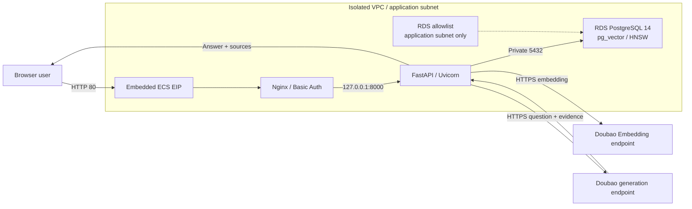

# Enterprise Knowledge QA on Volcengine

Use Terraform and the `volcengine/volcenginecc` provider to create a VPC, ECS host, RDS PostgreSQL 14, and Doubao model endpoints on Volcengine. The template automatically installs an enterprise knowledge QA application built with Nginx, FastAPI/Uvicorn, pg_vector, and HNSW. Users can upload TXT, Markdown, PDF, and DOCX documents and receive RAG answers with source evidence.

For the Chinese version, see [README.zh-CN.md](README.zh-CN.md).

## 1. Business Background

General-purpose language models do not contain private enterprise knowledge and cannot reliably track changing product documentation, operating procedures, and business rules. Direct use in customer service or internal QA can therefore produce knowledge gaps and answers without traceable evidence.

RAG retrieves relevant enterprise knowledge before generation and combines the question with matching passages as model context. This solution provides document ingestion, vector retrieval, answer generation, and evidence display for demonstrations and functional validation.

## 2. Solution Overview

- **Network**: creates an isolated VPC, application subnet, and security group. Public ingress is limited to HTTP 80 and optional restricted SSH 22.
- **Compute**: creates an Ubuntu 24.04 ECS instance with an embedded EIP. Nginx provides Basic Auth and reverse proxying; FastAPI/Uvicorn listens only on loopback.
- **Database**: creates RDS PostgreSQL 14, an application-subnet allowlist, a UTF-8 database, and a bootstrap account. No public database endpoint is created.
- **Models**: creates Doubao generation and embedding endpoints by default, or reuses existing endpoints.
- **Delivery**: stores non-secret application source in TOS. ECS cloud-init downloads and verifies it, then systemd installs and checks the application.



Workflows:

1. **Ingestion**: upload → validate and parse → chunk → embed → store in PostgreSQL → search through HNSW.
2. **Question answering**: embed question → cosine Top K → distance filter → compose prompt → generate → display sources, chunks, and distance.

Defaults are `doubao-seed-2-0-lite / 260428`, `doubao-embedding-vision / 251215`, and 1024 dimensions. Confirm model, version, region, and output-dimension availability before deployment.

## 3. IaC Design

### 3.1 Managed Resources

Create mode manages 12 cloud resources, two destroy-only waits, and two Terraform validation objects. Reuse mode omits the two Ark endpoints.

| Terraform resource | Count | Purpose |
| --- | ---: | --- |
| `volcenginecc_vpc_vpc` | 1 | Isolated VPC |
| `volcenginecc_vpc_subnet` | 1 | ECS and RDS application subnet |
| `volcenginecc_vpc_security_group` | 1 | HTTP and optional SSH source control |
| `volcenginecc_ecs_instance` | 1 | Application host, system disk, primary ENI, and embedded EIP |
| `volcenginecc_rdspostgresql_allow_list` | 1 | Allows only the application subnet |
| `volcenginecc_rdspostgresql_instance` | 1 | PostgreSQL 14 primary and secondary nodes |
| `volcenginecc_rdspostgresql_database` | 1 | UTF-8 RAG database |
| `volcenginecc_rdspostgresql_db_account` | 1 | RDS Super bootstrap account |
| `volcenginecc_ark_endpoint` | 2 or 0 | Generation and embedding endpoints |
| `volcenginecc_tos_bucket` / `volcenginecc_tos_object` | 1 / 1 | Non-secret source delivery |
| `time_sleep` | 2 | Waits for allowlist and ENI detachment |
| `terraform_data` | 2 | Input and endpoint-selection validation |

EIP, system disk, primary ENI, and RDS nodes are embedded in parent resources. The `ragapp` SQL role, Web credentials, and installed software created on ECS are not Terraform cloud resources.

Key behavior:

- RDS references the allowlist through `allow_list_ids`; destroy waits 300 seconds for allowlist detachment.
- Network cleanup waits 60 seconds after ECS deletion for ENI detachment.
- The public TOS object contains application and installer code only, with no passwords, API Keys, or enterprise documents.
- pg_vector, tables, and HNSW indexes are initialized idempotently; startup validates vector dimensions and the embedding endpoint.
- Reuploading the same filename atomically replaces prior chunks; generation is skipped when no evidence passes the threshold.
- No Cloud Assistant Command or Invocation resources are created.

### 3.2 Main Inputs

See [variables.tf](variables.tf) for complete definitions and validation rules.

| Inputs | Default | Description |
| --- | --- | --- |
| `region` / `zone_id` | `cn-beijing` / `cn-beijing-a` | Region and zone |
| `project_name` / `name_prefix` | `default` / `enterprise-ai-qa` | Cloud project and resource prefix |
| `vpc_cidr` / `subnet_cidr` | `10.40.0.0/16` / `10.40.1.0/24` | Network and RDS allowlist CIDRs |
| `web_source_cidr` | Required | HTTP 80 source CIDR |
| `ssh_source_cidr` | `null` | SSH source; `null` disables public SSH |
| `image_id` | Required | Ubuntu 24.04 x86_64 image ID |
| `instance_type` | `ecs.g3i.large` | ECS instance type |
| `system_disk_size_gb` / `public_bandwidth_mbps` | `40` / `5` | System disk and EIP bandwidth |
| `ecs_login_mode` | `key_pair` | `key_pair` or `password` |
| `key_pair_name` / `ecs_password` | `null` / `null` | The single credential matching the login mode |
| `postgres_version` | `PostgreSQL_14` | Fixed database version |
| `postgres_node_spec` / `postgres_storage_gb` | `rds.postgres.1c2g` / `100` | RDS specification and storage |
| `postgres_database_name` | `ragdb` | RAG database |
| `postgres_admin_username` | `ragbootstrap` | RDS bootstrap account |
| `postgres_admin_password` | Required, sensitive, no default | RDS bootstrap password; `null` is not allowed |
| `ark_api_key` | Required, sensitive | Manually created Ark API Key |
| `create_model_endpoints` | `true` | Create or reuse model endpoints |
| `llm_endpoint_id` / `embedding_endpoint_id` | Empty | Required in reuse mode |
| Model names and versions | See `variables.tf` | Generation and embedding models |
| `embedding_dimensions` | `1024` | Model, vector-column, and index dimensions |
| `chunk_size` / `chunk_overlap` | `800` / `120` | Chunk size and overlap |
| `default_top_k` | `5` | Default retrieval count |
| `max_upload_bytes` | `10485760` | Maximum upload size |
| `max_cosine_distance` | `0.65` | Cosine-distance filter |

ECS login modes are mutually exclusive:

An unused credential may be `null`, an empty string (`""`), or a blank platform input. The template normalizes empty and whitespace-only strings to `null` before checking mutual exclusivity and passing credentials to ECS. Password mode still requires a valid password, and key-pair mode still requires an existing key-pair name. Supplying both credentials is rejected. The string `"null"` is not a null value.

```hcl
# Key-pair mode
ecs_login_mode = "key_pair"
key_pair_name  = "your-existing-key-pair"
ecs_password   = null

# Password mode
ecs_login_mode = "password"
key_pair_name  = null
```

### 3.3 Outputs

| Outputs | Description |
| --- | --- |
| `web_url` | Public HTTP application URL |
| `ecs_instance_id` / `ecs_public_ip` / `ecs_private_ip` | ECS identifiers and addresses |
| `postgres_instance_id` / `postgres_private_domain` / `postgres_private_port` | RDS identifier and private address |
| `postgres_database_name` | RAG database name |
| `llm_endpoint_id` / `embedding_endpoint_id` | Effective model endpoints |
| `embedding_dimensions` | Vector dimensions |
| `vpc_id` / `subnet_id` / `security_group_id` | Network identifiers |
| `source_bucket_name` | TOS source bucket |
| `deployment_next_step` | Readiness and Web-credential guidance |

No output returns the RDS password, Ark Key, application database password, or Web password.

### 3.4 Get an Ark API Key

`ark_api_key` authenticates the application's calls to the Doubao generation and Embedding models. It is different from a cloud account's Access Key / Secret Key and an `ep-...` endpoint ID. The template creates or reuses endpoints, but does not create an API Key.

1. **Open the Ark console and select the region and project.** Open the [Ark console](https://console.volcengine.com/ark), select Beijing (`cn-beijing`), and switch to the project matching the template's `project_name`; the current parameter file uses `default`. The API Key and model endpoints must belong to the same project.

2. **Create an API Key.** Open [API Key Management](https://ark.volcengine.com/region:cn-beijing/apiKey), click **Create API Key**, enter a name, and confirm creation. The Key must authorize calls to both the generation and Embedding endpoints. With the default `create_model_endpoints = true`, those endpoints are created during deployment, so the Key must not be restricted to previously existing endpoints only. In reuse mode, access can be restricted to the two endpoint IDs being used.

3. **Copy the Key and supply the deployment parameter.** View the new Key in the API Key list and copy its full value. When creating an InfraManager stack, enter it in the sensitive parameter `ark_api_key`. For local deployment, replace the `ark_api_key` example in `terraform.tfvars`, or set `TF_VAR_ark_api_key` as described in Section 4.2; comment out or remove the corresponding file assignment before using the environment variable.

See the [official API Key guide](https://docs.volcengine.com/docs/ark/api-key?lang=zh) for console instructions and project permission rules.

## 4. Usage

### 4.1 InfraManager Deployment

The stack execution identity needs CloudControl and resource-management permissions for VPC, ECS, RDS PostgreSQL, Ark endpoints, and TOS. The template creates no IAM roles or policies and does not require `iam:CreateRole` or `iam:PassRole`.

Upload the complete release package in the [InfraManager console](https://console.volcengine.com/iac) and create a stack. Required inputs are:

- `image_id`
- `web_source_cidr`
- `postgres_admin_password`
- `ark_api_key`; see [Section 3.4](#34-get-an-ark-api-key) for setup instructions
- an existing `key_pair_name` in default key-pair mode, or `ecs_password` in password mode

The release package includes the current `terraform.tfvars`. Review its region, image, specifications, key-pair name, endpoint prefix, and source CIDRs before upload. Its current Web and SSH sources are `0.0.0.0/0`, suitable only for temporary testing.

`postgres_admin_password` has no default, rejects `null`, and must be supplied explicitly. Its assignment in `terraform.tfvars` is commented out; uncomment it and enter the actual password when using file input. The ECS default password and Ark API Key example still need to be replaced before use. `ecs_password`, `postgres_admin_password`, and `ark_api_key` are marked `sensitive = true`. Use the platform's sensitive parameter inputs when deploying through InfraManager.

Review the execution plan before deployment. Stack success means cloud resources are created, not that application installation is complete. Check ECS:

```bash
sudo cat /opt/rag-qa-deploy/STATUS
sudo systemctl status rag-qa-install.service --no-pager
sudo journalctl -u rag-qa-install.service -n 80 --no-pager
```

Wait for `STATUS` to become `ready`, then read the Web credentials and open `web_url`:

```bash
sudo python3 -c 'import json; s=json.load(open("/opt/rag-qa-deploy/.runtime/secrets.json")); print(json.dumps({k:s[k] for k in ("web_username","web_password")}))'
```

### 4.2 Local Deployment

Prepare Terraform `>= 1.5.7`. Provider versions are pinned to `volcenginecc 0.0.72` and `time 0.14.2`.

Choose either input method for passwords and API Keys:

- File input: uncomment the database password assignment in `terraform.tfvars` and enter the actual password, then replace the API Key example.
- Environment variables: comment out or remove the corresponding assignments in `terraform.tfvars`, then set `TF_VAR_*`. Automatically loaded variable files take precedence over environment variables, including assignments set to `null`.

The commands below use environment variables for the database password and Ark API Key. `sensitive` hides values in normal Terraform output; it does not encrypt variable files or State, or change input precedence. Do not commit files containing actual credentials.

```bash
export VOLCENGINE_ACCESS_KEY='<access-key>'
export VOLCENGINE_SECRET_KEY='<secret-key>'

# Review terraform.tfvars and comment out or remove its postgres_admin_password and ark_api_key assignments.
export TF_VAR_postgres_admin_password='<new-rds-password>'
export TF_VAR_ark_api_key='<ark-api-key>'

terraform init
terraform fmt -check -recursive
terraform validate
terraform plan -out=qa.tfplan
terraform show qa.tfplan
terraform apply qa.tfplan
```

For password login, inject `TF_VAR_ecs_password` and remove `ecs_password = null` from `terraform.tfvars`; otherwise the automatically loaded variable file overrides the environment variable.

### 4.3 Validation and Destroy

At minimum:

1. Confirm RDS has only a private endpoint, its allowlist contains only the application subnet, and public ingress does not expose 5432 or 8000.
2. Upload TXT, Markdown, PDF, and DOCX; verify sources, chunks, 1024-dimensional vectors, and the HNSW index.
3. Verify a known-answer question retrieves correct evidence, and an unrelated question is refused when no evidence qualifies.
4. Confirm empty, oversized, malformed, and unsupported files do not write dirty data.
5. Reupload the same filename and restart the app; existing knowledge and indexes must remain usable.
6. Confirm `terraform plan -detailed-exitcode` returns 0.

Back up knowledge data and review the destroy plan:

```bash
terraform plan -destroy -out=destroy.tfplan
terraform show destroy.tfplan
terraform apply destroy.tfplan
terraform state list
```

The final command should return no resources. Reused Ark endpoints, the existing ECS key pair, and the manually created Ark API Key are not deleted with the stack.

## 5. Scope

This template is intended for enterprise knowledge QA demonstrations, functional validation, and small non-critical workloads. It is not a production high-availability architecture.

- One ECS instance, with no load balancer or application replicas.
- RDS primary and secondary nodes are in the same zone as the application by default.
- HTTP + Basic Auth is not production authentication; production requires TLS, SSO, authorization, rate limiting, auditing, and WAF controls.
- `postgres_admin_password`, `ark_api_key`, and optional `ecs_password` enter Terraform State; the first two also enter ECS user data. Use an encrypted, access-controlled, environment-isolated backend.
- Ark Key renewal is manual and requires a new stack or reviewed ECS replacement to deliver the new value.
- The TOS source object is publicly readable and must contain public code only.
- Scanned PDFs require external OCR; changing the embedding model or dimensions requires rebuilding the knowledge base and indexes.
- The template does not provide knowledge-base backup, cross-region disaster recovery, monitoring, alerting, or recovery drills.

The source construction plan requires database passwords and Ark Keys to stay out of State. This manual-input variant does not satisfy that requirement. Use an ECS role/STS, an external secret manager, or another mechanism that bypasses Terraform State when that constraint is required.
