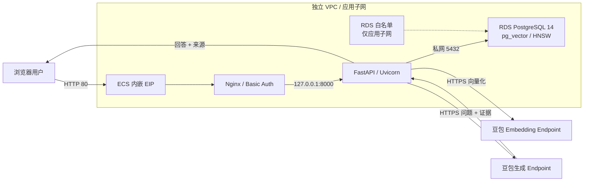

# 快速搭建企业智能问答系统

使用 Terraform 和 `volcengine/volcenginecc` Provider，在火山引擎创建 VPC、ECS、RDS PostgreSQL 14 和豆包模型 Endpoint，并自动安装基于 Nginx、FastAPI/Uvicorn、pg_vector 与 HNSW 的企业知识问答应用。支持上传 TXT、Markdown、PDF 和 DOCX，通过 RAG 获得带来源证据的回答。

英文说明见 [README.md](README.md)。

## 1. 业务背景

通用大模型缺少企业私域知识，也无法及时掌握持续变化的产品说明、操作规范和业务规则，直接用于企业客服或内部问答时容易出现知识缺口和依据不透明等问题。

RAG 在生成回答前先检索企业知识库，将用户问题和相关片段组合为 Prompt，为大模型补充可追溯的上下文。本方案提供知识入库、向量检索、回答生成和证据展示流程，适合快速搭建演示和功能验证环境。

## 2. 方案概述

- **网络**：创建独立 VPC、应用子网和安全组。公网开放 HTTP 80，以及可选的受限来源 SSH 22。
- **计算**：创建 Ubuntu 24.04 ECS 和内嵌 EIP。Nginx 负责 Basic Auth 和反向代理，FastAPI/Uvicorn 仅监听本机回环地址。
- **数据库**：创建 RDS PostgreSQL 14、应用子网白名单、UTF-8 数据库和初始化账号。数据库不提供公网 Endpoint。
- **模型**：默认创建豆包生成模型与向量模型两个 Ark Endpoint，也支持复用已有 Endpoint。
- **交付**：Terraform 将不含秘密的应用源码保存到 TOS；ECS cloud-init 下载并校验后，通过 systemd 完成安装和健康检查。



业务链路：

1. **知识入库**：上传文档 → 校验与解析 → 文本切片 → 生成向量 → 写入 PostgreSQL → HNSW 检索。
2. **问答检索**：问题向量化 → Top K 余弦距离检索 → 距离过滤 → 组合 Prompt → 生成回答 → 展示来源、切片和距离。

默认使用 `doubao-seed-2-0-lite / 260428`、`doubao-embedding-vision / 251215` 和 1024 维向量。部署前需确认模型、版本、地域和输出维度可用。

## 3. IaC 设计

### 3.1 资源清单

新建 Endpoint 模式管理 12 个云资源、2 个销毁等待对象和 2 个参数校验对象；复用 Endpoint 时不创建 2 个 Ark Endpoint。

| Terraform 资源 | 数量 | 用途 |
| --- | ---: | --- |
| `volcenginecc_vpc_vpc` | 1 | 独立 VPC |
| `volcenginecc_vpc_subnet` | 1 | ECS 与 RDS 应用子网 |
| `volcenginecc_vpc_security_group` | 1 | HTTP 与可选 SSH 来源控制 |
| `volcenginecc_ecs_instance` | 1 | 应用主机、系统盘、主网卡和内嵌 EIP |
| `volcenginecc_rdspostgresql_allow_list` | 1 | 仅允许应用子网访问 RDS |
| `volcenginecc_rdspostgresql_instance` | 1 | PostgreSQL 14 主备双节点 |
| `volcenginecc_rdspostgresql_database` | 1 | UTF-8 RAG 数据库 |
| `volcenginecc_rdspostgresql_db_account` | 1 | RDS Super 初始化账号 |
| `volcenginecc_ark_endpoint` | 2 或 0 | 生成与向量 Endpoint |
| `volcenginecc_tos_bucket` / `volcenginecc_tos_object` | 1 / 1 | 无秘密源码交付 |
| `time_sleep` | 2 | 等待白名单和 ENI 异步解绑 |
| `terraform_data` | 2 | 参数与 Endpoint 选择校验 |

EIP、系统盘、主网卡和 RDS 节点是父资源的内嵌属性。ECS 内创建的 `ragapp` SQL 角色、Web 凭据和应用软件不属于 Terraform 云资源。

关键设计：

- RDS 通过 `allow_list_ids` 引用白名单；销毁时等待白名单解绑 300 秒。
- ECS 删除后等待 ENI 解绑 60 秒，再回收安全组、子网和 VPC。
- TOS 对象公开读取，但仅包含应用和安装代码，不包含密码、API Key 或企业知识。
- pg_vector、表和 HNSW 索引可重复初始化；启动时校验向量维度和 Embedding Endpoint。
- 同名文件上传会原子替换旧切片；没有合格证据时不调用生成模型。
- 模板不创建 Cloud Assistant Command 或 Invocation。

### 3.2 主要输入

完整定义及校验规则见 [variables.tf](variables.tf)。

| 参数 | 默认值 | 说明 |
| --- | --- | --- |
| `region` / `zone_id` | `cn-beijing` / `cn-beijing-a` | 地域与可用区 |
| `project_name` / `name_prefix` | `default` / `enterprise-ai-qa` | 云项目与资源前缀 |
| `vpc_cidr` / `subnet_cidr` | `10.40.0.0/16` / `10.40.1.0/24` | 网络与 RDS 白名单网段 |
| `web_source_cidr` | 必填 | HTTP 80 来源 IPv4 CIDR |
| `ssh_source_cidr` | `null` | SSH 来源；`null` 关闭公网 SSH |
| `image_id` | 必填 | Ubuntu 24.04 x86_64 镜像 ID |
| `instance_type` | `ecs.g3i.large` | ECS 规格 |
| `system_disk_size_gb` / `public_bandwidth_mbps` | `40` / `5` | 系统盘与 EIP 带宽 |
| `ecs_login_mode` | `key_pair` | `key_pair` 或 `password` |
| `key_pair_name` / `ecs_password` | `null` / `null` | 与登录模式匹配的唯一凭据 |
| `postgres_version` | `PostgreSQL_14` | 固定数据库版本 |
| `postgres_node_spec` / `postgres_storage_gb` | `rds.postgres.1c2g` / `100` | RDS 规格与存储 |
| `postgres_database_name` | `ragdb` | RAG 数据库名称 |
| `postgres_admin_username` | `ragbootstrap` | RDS 初始化账号 |
| `postgres_admin_password` | 必填、敏感 | RDS 初始化密码 |
| `ark_api_key` | 必填、敏感 | 手工创建的方舟 API Key |
| `create_model_endpoints` | `true` | 创建或复用模型 Endpoint |
| `llm_endpoint_id` / `embedding_endpoint_id` | 空 | 复用模式必填 |
| 模型名称与版本 | 见 `variables.tf` | 生成模型与向量模型 |
| `embedding_dimensions` | `1024` | 模型、向量列和索引维度 |
| `chunk_size` / `chunk_overlap` | `800` / `120` | 切片长度与重叠 |
| `default_top_k` | `5` | 默认召回数量 |
| `max_upload_bytes` | `10485760` | 单文件上传上限 |
| `max_cosine_distance` | `0.65` | 余弦距离过滤上限 |

ECS 登录方式互斥：

```hcl
# 密钥对模式
ecs_login_mode = "key_pair"
key_pair_name  = "your-existing-key-pair"
ecs_password   = null

# 密码模式
ecs_login_mode = "password"
key_pair_name  = null
```

### 3.3 输出

| 输出 | 说明 |
| --- | --- |
| `web_url` | 应用公网 HTTP 地址 |
| `ecs_instance_id` / `ecs_public_ip` / `ecs_private_ip` | ECS 标识和地址 |
| `postgres_instance_id` / `postgres_private_domain` / `postgres_private_port` | RDS 标识与私网地址 |
| `postgres_database_name` | RAG 数据库名称 |
| `llm_endpoint_id` / `embedding_endpoint_id` | 实际模型 Endpoint |
| `embedding_dimensions` | 向量维度 |
| `vpc_id` / `subnet_id` / `security_group_id` | 网络资源标识 |
| `source_bucket_name` | TOS 源码 Bucket |
| `deployment_next_step` | 应用就绪和 Web 凭据提示 |

输出不返回 RDS 密码、Ark Key、应用数据库密码或 Web 密码。

## 4. 使用说明

### 4.1 InfraManager 部署

资源栈执行身份需要 CloudControl，以及 VPC、ECS、RDS PostgreSQL、Ark Endpoint 和 TOS 的资源管理权限。模板不创建 IAM Role 或 Policy，不需要 `iam:CreateRole` 或 `iam:PassRole`。

在 [InfraManager 控制台](https://console.volcengine.com/iac) 上传完整发布包并创建资源栈。必填参数为：

- `image_id`
- `web_source_cidr`
- `postgres_admin_password`
- `ark_api_key`
- 默认密钥模式下的已有 `key_pair_name`，或密码模式下的 `ecs_password`

发布包包含当前 `terraform.tfvars`。上传前必须检查其中的地域、镜像、规格、密钥对、Endpoint 前缀和来源 CIDR。当前 Web 与 SSH 来源为 `0.0.0.0/0`，只适合临时测试。

创建并审查执行计划，确认来源网段、资源规格、Endpoint 新建/复用边界，以及所有替换和删除符合预期后再部署。

资源栈成功只表示云资源创建完成。通过 ECS 控制台终端检查：

```bash
sudo cat /opt/rag-qa-deploy/STATUS
sudo systemctl status rag-qa-install.service --no-pager
sudo journalctl -u rag-qa-install.service -n 80 --no-pager
```

等待 `STATUS` 为 `ready`，再读取 Web 登录信息并访问 `web_url`：

```bash
sudo python3 -c 'import json; s=json.load(open("/opt/rag-qa-deploy/.runtime/secrets.json")); print(json.dumps({k:s[k] for k in ("web_username","web_password")}))'
```

### 4.2 本地部署

准备 Terraform `>= 1.5.7`。Provider 精确固定为 `volcenginecc 0.0.72` 和 `time 0.14.2`。

```bash
export VOLCENGINE_ACCESS_KEY='<access-key>'
export VOLCENGINE_SECRET_KEY='<secret-key>'

# 审查并修改 terraform.tfvars。
export TF_VAR_postgres_admin_password='<new-rds-password>'
export TF_VAR_ark_api_key='<ark-api-key>'

terraform init
terraform fmt -check -recursive
terraform validate
terraform plan -out=qa.tfplan
terraform show qa.tfplan
terraform apply qa.tfplan
```

密码登录时通过 `TF_VAR_ecs_password` 输入密码，并从 `terraform.tfvars` 删除 `ecs_password = null`，否则自动加载的变量文件会覆盖环境变量。

### 4.3 验证与销毁

部署后至少验证：

1. RDS 只有私网 Endpoint，白名单仅包含应用子网，公网未开放 5432 或 8000。
2. 分别上传 TXT、Markdown、PDF 和 DOCX，核对来源、切片、1024 维向量和 HNSW 索引。
3. 已知问题命中正确证据；没有合格证据时明确拒答。
4. 空文件、超限文件、损坏文件和不支持格式不写入脏数据。
5. 重复上传同名文档并重启应用后，知识和索引保持可用。
6. `terraform plan -detailed-exitcode` 返回 0。

销毁前备份知识数据并审查计划：

```bash
terraform plan -destroy -out=destroy.tfplan
terraform show destroy.tfplan
terraform apply destroy.tfplan
terraform state list
```

最后一条命令应无输出。复用的 Ark Endpoint、已有 ECS 密钥对和手工创建的 Ark API Key不会随资源栈删除。

## 5. 适用范围

本模板适用于企业知识问答演示、功能验证和小规模非关键业务，不属于生产高可用方案。

- 单 ECS，无负载均衡和应用多副本。
- RDS 主备节点默认与应用位于同一可用区。
- HTTP + Basic Auth 不是生产认证；正式使用需增加 TLS、SSO、授权、限流、审计和 WAF。
- `postgres_admin_password`、`ark_api_key` 和可选 `ecs_password` 会进入 Terraform State；前两者还会进入 ECS user data。必须使用加密、访问受控且按环境隔离的 Backend。
- Ark Key 不自动续期；轮换后需通过新资源栈或 ECS 替换流程重新下发。
- TOS 源码对象公开读取，只能包含可公开代码。
- 扫描 PDF 需要外部 OCR；更换 Embedding 模型或维度必须重建知识库和索引。
- 模板不提供知识库备份、跨地域灾备、监控告警和恢复演练。

建设计划原要求数据库密码和 Ark Key 不进入 State；当前手填参数版本不满足该项要求。若需要满足该约束，应改用实例角色/STS、外部秘密管理服务或其他不经 Terraform State 传递秘密的方案。
