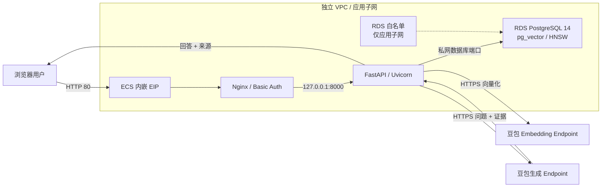

# 快速搭建企业智能问答系统

使用 Terraform 和 `volcengine/volcenginecc` Provider，在火山引擎创建 VPC、ECS、RDS PostgreSQL 14 和豆包模型 Endpoint，并自动安装基于 Nginx、FastAPI/Uvicorn、pg_vector 与 HNSW 的企业知识问答应用。支持上传 TXT、Markdown、PDF 和 DOCX，通过 RAG 获得带来源证据的回答，适合演示、功能验证和小规模非关键业务。

## 1. 业务背景

企业客服和内部问答需要依据产品说明、操作规范和业务规则回答问题，通用大模型难以直接满足这些要求。

- **私域知识缺失**：模型不了解企业内部资料，也无法及时掌握持续变化的业务规则。
- **回答依据不透明**：直接生成的回答缺少可核对的来源，用户难以判断是否可信。
- **知识维护成本高**：文档格式不统一，人工整理和逐条更新问答库耗时。

本方案在生成回答前检索企业知识库，将问题和相关片段组合为 Prompt。通过文档入库、向量检索、回答生成和证据展示，让用户能够维护知识并核对回答依据。

## 2. 方案概述

- **网络**：创建独立 VPC、应用子网和安全组。公网开放 HTTP 80，以及可选的 SSH 22；来源由参数控制。
- **计算**：创建 Ubuntu 24.04 ECS 和内嵌 EIP。Nginx 提供 Basic Auth 和反向代理，FastAPI/Uvicorn 仅监听 `127.0.0.1:8000`。
- **数据库**：创建 RDS PostgreSQL 14、应用子网白名单、UTF-8 数据库和初始化账号，仅提供私网连接。
- **模型**：默认创建豆包生成模型与向量模型两个 Ark Endpoint，也支持复用已有 Endpoint。
- **交付**：Terraform 将不含秘密的应用源码保存到 TOS；ECS cloud-init 下载并校验后，通过 systemd 自动安装、初始化数据库和检查应用健康。



知识入库流程为：上传文档 → 校验与解析 → 文本切片 → 生成向量 → 写入 PostgreSQL。问答流程为：问题向量化 → HNSW Top K 余弦距离检索 → 距离过滤 → 组合 Prompt → 生成回答 → 展示来源、切片和距离。同名文件上传会原子替换旧切片；没有符合阈值的证据时不调用生成模型。

默认使用 `doubao-seed-2-0-lite / 260428`、`doubao-embedding-vision / 251215` 和 1024 维向量，部署前需确认所选地域、模型版本和输出维度可用。数据库端口以 `postgres_private_port` 输出为准。

TOS 公开对象只包含源码；密码和 Ark API Key 通过 ECS user data 下发，并会进入 Terraform State。`sensitive = true` 只隐藏常规输出，Base64 编码也不提供加密。部署前必须准备访问受控、加密且按环境隔离的 State 存储。

## 3. IaC 设计

### 3.1 资源清单

当前 `terraform.tfvars` 使用 `create_model_endpoints = true`：创建 12 个云资源，另有 2 个销毁等待对象和 2 个参数校验对象，共 16 个 Terraform 管理对象。复用 Endpoint 时创建 10 个云资源及相同的 4 个辅助对象。

| Terraform 资源 | 数量 | 用途 |
| --- | ---: | --- |
| `volcenginecc_vpc_vpc` | 1 | 独立 VPC |
| `volcenginecc_vpc_subnet` | 1 | ECS 与 RDS 应用子网 |
| `volcenginecc_vpc_security_group` | 1 | HTTP 与可选 SSH 来源控制 |
| `volcenginecc_ecs_instance` | 1 | 应用主机、系统盘、主网卡和内嵌 EIP |
| `volcenginecc_rdspostgresql_allow_list` | 1 | 仅允许应用子网访问 RDS |
| `volcenginecc_rdspostgresql_instance` | 1 | PostgreSQL 14 主备双节点 |
| `volcenginecc_rdspostgresql_database` | 1 | UTF-8 RAG 数据库 |
| `volcenginecc_rdspostgresql_db_account` | 1 | RDS Super 初始化账号 |
| `volcenginecc_ark_endpoint` | 2 或 0 | 新建生成与向量 Endpoint；复用模式不创建 |
| `volcenginecc_tos_bucket` | 1 | 源码交付 Bucket |
| `volcenginecc_tos_object` | 1 | 无秘密的公开源码对象 |
| `time_sleep` | 2 | 销毁时等待白名单与网络解绑 |
| `terraform_data` | 2 | 运行参数、登录方式与 Endpoint 选择校验 |

EIP、系统盘、主网卡和 RDS 节点属于父资源的内嵌配置，不单独计数。ECS 中的 `ragapp` SQL 角色、Web 凭据和应用软件由安装流程创建，不是独立 Terraform 云资源。

工程没有 Data Source，也不创建 IAM Role、Policy、Cloud Assistant Command 或 Invocation。调用方需提供已有 ECS 密钥对（密钥模式）、手工创建的 Ark API Key，以及复用模式所需的两个 Endpoint ID。

### 3.2 工程结构

```text
.
├── modules/
│   ├── network/
│   │   ├── main.tf
│   │   ├── variables.tf
│   │   ├── outputs.tf
│   │   └── versions.tf
│   ├── database/
│   │   ├── main.tf
│   │   ├── variables.tf
│   │   ├── outputs.tf
│   │   └── versions.tf
│   ├── inference/
│   │   ├── main.tf
│   │   ├── variables.tf
│   │   ├── outputs.tf
│   │   └── versions.tf
│   ├── delivery/
│   │   ├── main.tf
│   │   ├── variables.tf
│   │   ├── outputs.tf
│   │   ├── versions.tf
│   │   └── templates/
│   │       ├── auto-install.sh
│   │       └── ecs-runtime.py
│   └── compute/
│       ├── main.tf
│       ├── variables.tf
│       ├── outputs.tf
│       ├── versions.tf
│       └── templates/
│           └── bootstrap-host.sh.tftpl
├── app/
│   ├── main.py
│   ├── requirements.txt
│   ├── static/
│   │   └── style.css
│   └── templates/
│       └── index.html
├── main.tf
├── locals.tf
├── variables.tf
├── outputs.tf
├── providers.tf
├── versions.tf
├── terraform.tfvars
├── README.md
├── README.zh-CN.md
└── LICENSE
```

`network` 提供 VPC、子网和安全组；`database` 使用这些网络资源建立私网数据库；`inference` 创建或选择模型接入点；`delivery` 打包源码；`compute` 接收数据库、模型和源码信息，启动自动安装。根模块通过 `locals.tf` 归一化登录凭据并生成运行配置。

### 3.3 核心代码示例

根模块 `main.tf` 将网络输出传入数据库模块，并用销毁等待对象控制回收顺序：

```hcl
resource "time_sleep" "before_network_destroy" {
  destroy_duration = "60s"
  depends_on       = [module.network]
}

module "database" {
  source = "./modules/database"

  name_prefix       = var.name_prefix
  project_name      = var.project_name
  zone_id           = var.zone_id
  vpc_id            = module.network.vpc_id
  subnet_id         = module.network.subnet_id
  subnet_cidr       = var.subnet_cidr
  db_engine_version = var.postgres_version
  node_spec         = var.postgres_node_spec
  storage_space_gb  = var.postgres_storage_gb
  database_name     = var.postgres_database_name
  admin_username    = var.postgres_admin_username
  admin_password    = var.postgres_admin_password
  tags_list         = local.tags_list
  depends_on        = [time_sleep.before_network_destroy]
}
```

数据库模块通过 `allow_list_ids` 绑定应用子网白名单。销毁时，数据库模块另等待 300 秒再移除白名单；根模块等待网络解绑后再回收 VPC 资源。这些等待只发生在销毁阶段。

## 4. 使用说明

本工程支持通过 InfraManager 在云上一键部署或下载模板在本地运行。推荐使用云上部署方式，无需自行准备 Terraform 运行环境，只需在平台填写参数即可完成资源创建和托管。

### 4.1 云上部署

InfraManager 是火山引擎提供的 Terraform 托管工作台，更多产品介绍参见 [InfraManager 产品介绍](https://docs.volcengine.com/docs/infrastructure-management/product-introduction?lang=zh)。

#### 4.1.1 准备权限

资源栈执行身份需要 CloudControl，以及 VPC、子网、安全组、ECS（含磁盘、网卡、EIP、密钥对绑定）、RDS PostgreSQL（含白名单、账号、数据库）、Ark Endpoint 和 TOS Bucket/Object 的创建、读取、更新、删除及相关标签、关联操作权限。复用模式需有使用目标 Endpoint 的权限。模板不创建 IAM 角色，无需为创建本模板资源添加 `iam:CreateRole` 或 `iam:PassRole`。

在控制台开通 ECS、RDS PostgreSQL、TOS 和火山方舟；确认地域内有 Ubuntu 24.04 x86_64 镜像、ECS/RDS 规格库存、EIP 与存储配额，以及两个模型的使用权限。默认配置使用北京地域 `cn-beijing`、可用区 `cn-beijing-a`。ECS 需要访问 TOS、Ubuntu 软件源、Python 包源和 Ark HTTPS 接口。

`ark_api_key` 用于模型推理，与云账号 AK/SK、`ep-...` 接入点 ID 不同，模板不会自动创建它：

1. 打开 [火山方舟控制台](https://console.volcengine.com/ark)，选择部署地域，并切换到与 `project_name` 一致的项目；默认是 `default`。API Key 和两个 Endpoint 必须属于同一个项目。
2. 在 [API Key 管理](https://ark.volcengine.com/region:cn-beijing/apiKey) 中创建 API Key。权限需覆盖生成和 Embedding 两个接入点；新建模式下不要仅授权给此前已有的接入点，复用模式可限定为目标两个 Endpoint。
3. 复制完整密钥，填写资源栈敏感参数 `ark_api_key`。本地环境变量输入方法见第 4.2.1 节。操作说明见 [官方 API Key 获取指南](https://docs.volcengine.com/docs/ark/api-key?lang=zh)。

#### 4.1.2 选择模板

打开 [InfraManager 控制台](https://console.volcengine.com/iac)，进入 **模板管理 > 公开模板**，搜索“快速搭建企业智能问答系统”。

公开模板需由平台发布后才能搜索到。使用本地修订版本时，将包含根目录文件、`modules/` 和 `app/` 的完整模板包导入模板管理，再选择导入的模板创建资源栈。

#### 4.1.3 创建资源栈

选择模板并点击 **创建资源栈**，根据实际需求填写资源栈信息和模板参数。创建并检查执行计划，确认变更符合预期后，点击 **执行部署**。

必须填写 `image_id`、`web_source_cidr`、`postgres_admin_password`、`ark_api_key`，并提供登录模式对应的 ECS 凭据。完整参数表在第 4.2.1 节，云上与本地使用相同约束。

部署前检查模板包中的 `terraform.tfvars`：镜像和密钥对名称必须属于目标地域；Web 与 SSH 示例来源均为 `0.0.0.0/0`，应改为实际出口 CIDR，或将 SSH 设为 `null`；RDS 示例规格为 `rds.postgres.2c4g`。密码模式需清空 `key_pair_name` 并提供实际 `ecs_password`，不要使用代码中的示例默认密码。

`postgres_admin_password` 无默认值且不允许 `null`；`ark_api_key` 的示例值必须替换。通过平台敏感参数输入时，检查计划确实使用了输入值，避免包内同名赋值覆盖凭据。确认新建/复用 Endpoint 的选择及所有删除、替换操作符合预期。

#### 4.1.4 部署验证

在资源栈详情页查看部署状态为“成功”，再查看模板输出：

| 输出 | 用途 |
| --- | --- |
| `web_url` | 公网 HTTP 应用地址 |
| `ecs_instance_id` | 在 ECS 控制台定位应用主机 |
| `ecs_public_ip` | ECS 公网 IP |
| `ecs_private_ip` | ECS 私网 IP |
| `ecs_login_mode` | ECS 登录模式 |
| `ecs_key_pair_name` | 密钥模式绑定的已有密钥对名称；密码模式为空 |
| `postgres_instance_id` | 在 RDS 控制台定位数据库 |
| `postgres_private_domain` | 实际私网连接域名 |
| `postgres_private_port` | 实际私网连接端口 |
| `postgres_database_name` | RAG 数据库名称 |
| `llm_endpoint_id` | 实际生成模型接入点 |
| `embedding_endpoint_id` | 实际向量模型接入点 |
| `embedding_dimensions` | 配置的向量维度 |
| `vpc_id` | VPC 标识 |
| `subnet_id` | 应用子网标识 |
| `security_group_id` | 安全组标识 |
| `source_bucket_name` | TOS 源码 Bucket |
| `runtime_config` | 不含秘密的地域、Ark 地址、切片与检索配置 |
| `deployment_next_step` | 应用就绪与 Web 凭据读取提示 |

这些输出均不返回密码或 API Key；这不代表 State 中没有秘密。资源页签中新建模式应有 12 个云资源及 4 个辅助对象，复用模式应有 10 个云资源及 4 个辅助对象。

1. **检查云资源和关系。** 用上述标识打开对应控制台详情页：ECS 应运行，RDS 应可用且只提供私网地址，白名单应仅包含 `subnet_cidr`；安全组只开放配置来源的 80 和可选 22，不对公网开放数据库端口或 8000；两个 Ark Endpoint 应可调用。复用模式核对输出 ID 等于输入 ID。异常先查来源网段、白名单、实例状态和模型权限。

2. **在 ECS 上检查安装和健康。** 在 ECS 控制台找到 `ecs_instance_id` 对应实例，打开控制台终端，以具备 sudo 权限的账号执行：

```bash
sudo cat /opt/rag-qa-deploy/STATUS
sudo systemctl is-active nginx rag-qa.service
curl --fail --silent --show-error --max-time 15 http://127.0.0.1:8000/healthz
curl --silent --output /dev/null --write-out '%{http_code}\n' --max-time 15 http://127.0.0.1/
```

预期依次为 `ready`、两个 `active`、`{"ok":true,"database":"ready"}`，以及未登录请求的 `401`。云资源创建成功后，应用安装可能仍在进行；没有达到预期时先查看：

```bash
sudo systemctl status rag-qa-install.service rag-qa.service nginx --no-pager
sudo journalctl -u rag-qa-install.service -u rag-qa.service -n 80 --no-pager
```

安装流程自动运行，无需手工执行源码脚本。下载或依赖安装失败先查 ECS 出网；数据库失败先查私网连接与白名单；模型失败先查 API Key、项目权限、Endpoint 和维度。排查时不要直接输出 `config.json` 或 `.runtime/runtime.env`，其中含秘密。临时停止安装重试用 `sudo systemctl stop rag-qa-install.service`；停止应用用 `sudo systemctl stop rag-qa.service`；恢复用对应的 `systemctl start`。

3. **读取 Web 凭据并登录。** 以下命令在 ECS 上执行，只显示 Web 用户名与密码：

```bash
sudo python3 -c 'import json; s=json.load(open("/opt/rag-qa-deploy/.runtime/secrets.json")); print("web_username", s["web_username"]); print("web_password", s["web_password"])'
```

在浏览器打开资源栈输出 `web_url`，将这两个字段填入登录弹窗。Web 账号由应用生成，与 ECS 或数据库登录凭据不同。

4. **验证知识入库和问答。** 准备内容明确的 `qa-check.txt`、`qa-check.md`、`qa-check.pdf` 和 `qa-check.docx`，使用页面上传区依次上传。PDF 应含可提取文本，DOCX 应为有效文档。每次上传应返回来源和切片数量；询问文档中的已知事实，应得到相符回答及来源证据。再用明显无关的问题检查：当检索没有合格证据时应拒答。同名文件修改后重传，应替换原有切片。

在 ECS 上查询知识状态；按提示输入刚读取的 Web 用户名，再输入密码，密码不会放入命令参数：

```bash
read -r -p "Web username: " QA_WEB_USERNAME
curl --fail --silent --show-error --max-time 30 --user "$QA_WEB_USERNAME" http://127.0.0.1/api/knowledge
unset QA_WEB_USERNAME
```

上传后应看到 `ok = true`、`chunks > 0`、`configured_dimensions` 与 `min_dimensions`、`max_dimensions` 均为配置维度（默认 1024），`indexes` 含 `knowledge_chunks_embedding_hnsw`。失败先查安装及应用日志。空文件、损坏文件、不支持格式和超过 `max_upload_bytes` 的文件应被拒绝且不增加切片；其中超限请求也可能由 Nginx 返回 `413`。记录有效文件上传后的状态，再提交无效文件对比。

在 ECS 执行 `sudo systemctl restart rag-qa.service`，重新检查健康、知识状态和已知问题，数据及索引应仍可用。

5. **清理验证数据。** 应用没有文档删除按钮或删除 API。仅需删除上面四个测试文件时，在 ECS 执行以下命令；它只按这些确切文件名删除切片，请先确认没有业务文档使用相同名称：

```bash
sudo /opt/rag-qa-deploy/release/.venv/bin/python - <<'PY'
import json
from pathlib import Path
import psycopg

base = Path("/opt/rag-qa-deploy")
config = json.loads((base / "config.json").read_text())
stored = json.loads((base / ".runtime/secrets.json").read_text())
sources = ["qa-check.txt", "qa-check.md", "qa-check.pdf", "qa-check.docx"]
with psycopg.connect(
    host=config["postgres_private_domain"], port=config["postgres_private_port"],
    dbname=config["postgres_database_name"], user="ragapp",
    password=stored["db_password"], connect_timeout=10,
    options="-c statement_timeout=30000",
) as conn:
    with conn.cursor() as cur:
        cur.execute("DELETE FROM knowledge_chunks WHERE source = ANY(%s)", (sources,))
        print("deleted_chunks", cur.rowcount)
PY
```

此命令使用安装时已有的 Python 环境与 `psycopg`，无需另装依赖；连接超时 10 秒，SQL 超时 30 秒。成功退出码为 0，重复执行应删除 0 条；异常会非零退出，未提交事务会回滚。完成后重新查询 `/api/knowledge`。

### 4.2 本地部署

您也可以下载本工程模板在本地运行，需要按照下述步骤操作。

以下 Terraform 命令在下载的完整模板根目录执行；ECS 健康、登录和业务验证命令仍在 ECS 终端执行。

#### 4.2.1 环境准备

**基础环境**：Terraform `>= 1.5.7`；Provider 精确固定为 `volcengine/volcenginecc = 0.0.72` 和 `hashicorp/time = 0.14.2`。本地需要能够下载 Provider 并访问火山引擎 API。工程未附带 Lock File，初始化后应保留生成的 `.terraform.lock.hcl`。

**服务与配额**：按第 4.1.1 节在控制台开通服务、准备权限、镜像、规格、配额及 Ark API Key。密钥模式准备同地域已有密钥对；复用模式准备同项目、同地域可调用的生成和向量 Endpoint。ECS 的软件安装、私网数据库访问和模型推理网络条件与云上部署相同。

**凭证注入**（推荐环境变量，不要写入代码或 `tfvars`）：

```bash
export VOLCENGINE_ACCESS_KEY="your_access_key"
export VOLCENGINE_SECRET_KEY="your_secret_key"
export VOLCENGINE_REGION="cn-beijing"
```

Provider 显式使用 `var.region`，因此 `VOLCENGINE_REGION` 不会覆盖 `terraform.tfvars` 中的 `region`；两者应保持一致。

**敏感业务变量**：`postgres_admin_password` 是必填的初始化数据库密码，`ark_api_key` 是必填的模型调用密钥，`ecs_password` 仅用于密码登录，均标记为敏感。建议通过环境变量注入，不要写入 `terraform.tfvars`：

```bash
export TF_VAR_postgres_admin_password="<new-rds-password>"
export TF_VAR_ark_api_key="<ark-api-key>"
# 仅在密码模式下设置。
# export TF_VAR_ecs_password="<new-ecs-password>"
```

先注释或删除 `terraform.tfvars` 中对应变量的赋值：`ark_api_key` 当前有活跃示例值，数据库密码赋值已注释；密码模式还必须移除 `ecs_password = null`。自动加载的变量文件优先于 `TF_VAR_*`，即使文件值为 `null` 也会覆盖环境变量。文件输入时则需填写实际值并保护文件；不要提交真实凭据、Plan 或 State。

**重点参数**：下表覆盖全部根变量。“默认值”来自 `variables.tf`，不等于当前 `terraform.tfvars` 示例配置。

| 参数 | 默认值/入口 | 说明 |
| --- | --- | --- |
| `region` | `cn-beijing` | 部署地域，需支持所选服务和模型 |
| `zone_id` | `cn-beijing-a` | ECS 与 RDS 节点可用区，必须属于地域 |
| `project_name` | `default` | 云项目，需与 Ark Key、Endpoint 所属项目一致 |
| `name_prefix` | `enterprise-ai-qa` | 3–31 位小写字母、数字或连字符，以字母开头 |
| `vpc_cidr` | `10.40.0.0/16` | VPC 网段 |
| `subnet_cidr` | `10.40.1.0/24` | 应用与数据库子网、RDS 白名单网段 |
| `ssh_source_cidr` | `null` | SSH 来源 IPv4 CIDR；`null` 关闭，示例为 `0.0.0.0/0` |
| `image_id` | 必填 | 目标地域 Ubuntu 24.04 x86_64 镜像，`image-` 开头；替换包内示例 |
| `instance_type` | `ecs.g3i.large` | ECS 规格，需确认库存 |
| `ecs_login_mode` | `key_pair` | 仅支持 `key_pair` 或 `password` |
| `key_pair_name` | `null` | 密钥模式必填已有名称；密码模式留空，替换包内示例 |
| `ecs_password` | 公开示例密码 | 敏感；代码默认 `ReplaceWithStrongPassword123`，示例文件为 `null`；密码模式必须替换，8–30 位且至少三类字符 |
| `public_bandwidth_mbps` | `5` | 公网带宽，1–200 Mbps 整数 |
| `system_disk_size_gb` | `40` | 系统盘，40–2048 GiB 整数 |
| `postgres_version` | `PostgreSQL_14` | 本模板固定版本 |
| `postgres_node_spec` | `rds.postgres.1c2g` | 单节点规格；示例为 `rds.postgres.2c4g` |
| `postgres_storage_gb` | `100` | 20–3000 GiB，10 GiB 的整数倍 |
| `postgres_database_name` | `ragdb` | 小写字母开头，允许小写字母、数字和下划线 |
| `postgres_admin_username` | `ragbootstrap` | Terraform 创建的初始化管理员账号 |
| `postgres_admin_password` | 必填，无默认值，不允许 `null` | 敏感；8–32 位并符合 RDS 密码规则 |
| `ark_api_key` | 必填 | 敏感；不得为空，获取方法见第 4.1.1 节 |
| `llm_foundation_model` | `doubao-seed-2-0-lite` | 新建生成 Endpoint 的模型名称 |
| `llm_model_version` | `260428` | 新建生成 Endpoint 的模型版本 |
| `embedding_foundation_model` | `doubao-embedding-vision` | 新建向量 Endpoint 的模型名称 |
| `embedding_model_version` | `251215` | 新建向量 Endpoint 的模型版本 |
| `embedding_dimensions` | `1024` | 1–2000 整数，必须与模型输出和数据库向量列一致 |
| `moderation_strategy` | `Default` | 新建生成 Endpoint 的内容安全策略 |
| `common_tags` | `Project=enterprise-ai-qa; Environment=demo; ManagedBy=Terraform` | 统一资源标签，类型为字符串映射 |
| `web_source_cidr` | 必填 | HTTP 来源 IPv4 CIDR；示例为 `0.0.0.0/0`，应改为实际出口 |
| `create_model_endpoints` | `true` | 创建两个 Endpoint；`false` 为复用 |
| `model_endpoint_name_prefix` | `""` | 空值采用 `name_prefix`，否则为 3–48 位合法前缀；替换包内示例 |
| `llm_endpoint_id` | `""` | 复用模式必填有效 `ep-...`，新建模式必须为空 |
| `embedding_endpoint_id` | `""` | 复用模式必填有效 `ep-...`，新建模式必须为空 |
| `ark_base_url` | `""` | 空值按地域生成；自定义须为 `https://<host>/api/v3` 且不含凭据 |
| `chunk_size` | `800` | 切片字符数，128–8000 整数 |
| `chunk_overlap` | `120` | 非负整数，必须小于 `chunk_size` |
| `default_top_k` | `5` | 默认召回数，仅支持 3、5、8、10 |
| `max_upload_bytes` | `10485760` | 单文件字节上限，1–20971520 整数 |
| `max_cosine_distance` | `0.65` | 余弦距离阈值，范围 0–2，需用实际知识校准 |

登录凭据互斥：密钥模式需非空 `key_pair_name` 且 `ecs_password = null`；密码模式需实际密码且密钥名称为空。模板将凭据的 `null`、`""` 和纯空白视为未填写，字符串 `"null"` 不等于空值。使用代码默认值而不加载示例文件时，密钥模式也必须显式清空示例密码。

#### 4.2.2 场景化部署示例

初始化与校验：

```bash
terraform init
terraform fmt -check -recursive
terraform validate
```

**场景一：新建模型接入点，密钥登录 ECS。** 适用于没有可复用 Endpoint 的新环境。在 `terraform.tfvars` 设置以下选择，并完成第 4.2.1 节的镜像、CIDR 和凭据准备：

```hcl
create_model_endpoints = true
llm_endpoint_id        = ""
embedding_endpoint_id = ""
ecs_login_mode        = "key_pair"
key_pair_name         = "your-existing-key-pair"
ecs_password          = null
```

```bash
terraform plan -out=qa.tfplan
terraform show qa.tfplan
terraform apply qa.tfplan
```

预期创建第 3.1 节列出的 12 个云资源及 4 个辅助对象，并启动 ECS 自动安装。执行前审查计划，确认没有意外删除或替换。

**场景二：复用模型接入点，密码登录 ECS。** 适用于已有可用模型的独立新环境。将以下值改为实际 Endpoint；密码通过 `TF_VAR_ecs_password` 输入，因此文件中不能保留 `ecs_password` 赋值：

```hcl
create_model_endpoints = false
llm_endpoint_id        = "ep-your-llm-endpoint"
embedding_endpoint_id = "ep-your-embedding-endpoint"
ecs_login_mode        = "password"
key_pair_name         = null
```

```bash
export TF_VAR_ecs_password="<new-ecs-password>"
terraform plan -out=qa-reuse.tfplan
terraform show qa-reuse.tfplan
terraform apply qa-reuse.tfplan
```

预期创建 10 个云资源及 4 个辅助对象，输出两个复用 ID；不会创建、修改或删除外部接入点。两种登录模式与两种 Endpoint 模式也可以分别组合，只要满足互斥规则。

这些示例面向独立新环境。对已有资源栈将 `create_model_endpoints` 从 `true` 改为 `false` 会删除此前由模板管理的两个 Endpoint，不能用来保留它们。模型配置字段只作用于新建 Endpoint；复用模式需在方舟控制台核对已有模型与维度。

ECS 的 `user_data` 配置忽略后续变更，修改 Ark Key、切片或检索参数不会自动下发到运行中的应用。保留数据库而直接替换 ECS 也不是完整迁移：新主机生成的 `ragapp` 密码可能与已有 SQL 角色不同。已有环境变更需安排运行配置与凭据迁移；更换 Embedding Endpoint 或维度还需显式重建知识库，不能仅修改参数。

#### 4.2.3 部署预期结果

新建模式应有 12 个云资源及 4 个辅助对象；复用模式为 10 个云资源及 4 个辅助对象。EIP、磁盘、网卡和 RDS 主备节点不额外计数。

通过以下命令查看输出：

```bash
terraform output
terraform output -raw web_url
terraform output -raw ecs_instance_id
```

全部 19 个输出的含义见第 4.1.4 节。`deployment_next_step` 提示等待应用安装；Terraform Apply 完成不等于应用已经就绪。

#### 4.2.4 部署后验证

使用第 4.2.3 节命令获得 `web_url` 和 `ecs_instance_id`，并用 `terraform output` 获取网络、RDS 和两个 Endpoint 的标识。进入对应控制台核对资源关系；打开 ECS 控制台终端，执行第 4.1.4 节的状态、健康、凭据读取、四种格式上传、问答、异常文件、重启及测试数据清理步骤。浏览器使用本地输出的 `web_url`，不需要 InfraManager 资源栈。

复用模式额外核对两个输出 ID 与输入一致、所属项目允许 API Key 调用；密码模式确认 ECS 控制台登录可用，密钥模式确认绑定的密钥对名称正确。两者的 Web 登录仍使用 ECS 生成的 Web 凭据。

配置没有改变时，在本地根目录检查是否存在意外变更：

```bash
terraform plan -detailed-exitcode
```

预期退出码为 0；2 表示计划存在变更，应审查内容；1 表示执行错误。此检查不能代替应用业务验证。

#### 4.2.5 销毁资源

模板支持销毁其管理的整栈资源。先备份需要保留的知识数据，确认当前目录、Workspace、参数文件和凭据属于目标环境，再审查删除清单：

```bash
terraform plan -destroy
terraform destroy
```

注意事项：

- 销毁会删除模板管理的 ECS、RDS 数据库及实例、网络、TOS 源码和新建的 Ark Endpoint；数据库知识也会丢失。
- 保留同一环境的输入和敏感变量，销毁期间仍需通过变量校验；不要为了销毁切换登录模式或 Endpoint 开关。
- 白名单解绑等待 300 秒，网络解绑等待 60 秒，云服务删除还可能额外耗时。若失败，先核对控制台残留资源和错误，再继续处理，不要先删除 State。
- 复用的 Ark Endpoint、已有 ECS 密钥对和手工创建的 Ark API Key 不随资源栈删除；不再使用的 Key 需在方舟控制台单独撤销。
- 云上用户在目标资源栈中审查并执行销毁，无需本地 State。完成后核对资源列表；本地可运行 `terraform state list`，预期无资源条目。

## 5. 总结

本模板提供从基础设施创建到文档入库、向量检索和带来源回答的完整流程，支持四种文档格式、私网数据库、两种 ECS 登录方式，以及模型接入点的新建和复用。

适用于演示、功能验证和小规模非关键业务。应用为单 ECS，RDS 主备默认处于同一可用区；公网访问使用 HTTP + Basic Auth，尚不具备生产所需的 TLS、SSO、细粒度授权、备份、灾备和监控能力。扫描 PDF 需先做 OCR。

当前凭据设计会将数据库密码、Ark Key 和可选 ECS 密码保存在 State；`sensitive` 不能消除这一行为。若要求秘密不进入 State，需要调整秘密获取和初始化设计，不能仅靠修改参数或 README 达成。
